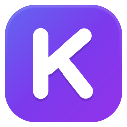
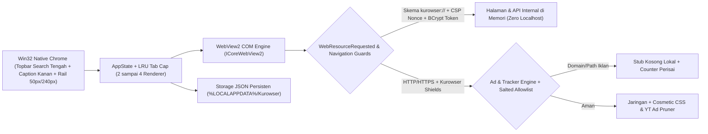
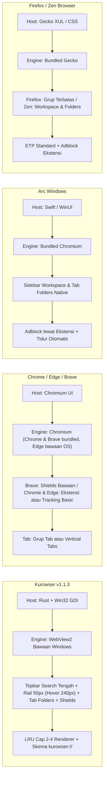
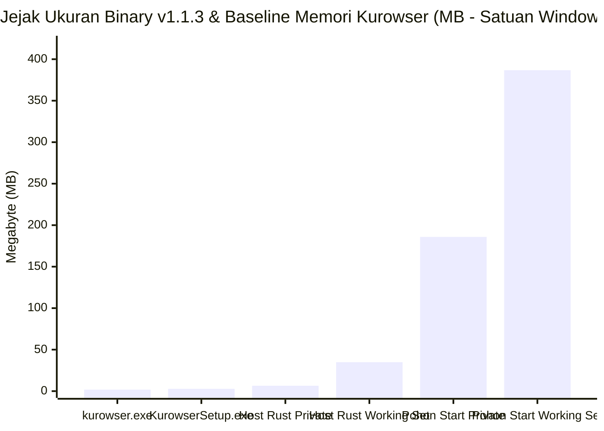

<div align="center">
  
  <h1>Kurowser</h1>
  <p>Browser Windows berbasis Rust, Win32 native, dan Microsoft Edge WebView2.</p>
  <p>Menggabungkan sidebar vertikal dengan Tab Folders, pemblokir iklan Kurowser Shields, pembatasan renderer aktif (LRU Tab Cap), dan halaman internal <code>kurowser://</code> tanpa membuka server <code>localhost</code>.</p>

  <br />

  <p>
    <a href="https://devkecelup.github.io/kurowser-web/">
      
    </a>
    <a href="https://github.com/devkecelup/kurowser/releases/latest">
      
    </a>
    
    
    
    
    <a href="LICENSE">
      
    </a>
  </p>

  <p>
    <a href="https://devkecelup.github.io/kurowser-web/"><strong>Unduh lewat Portal Resmi</strong></a> &middot; <a href="https://github.com/devkecelup/kurowser/releases/latest">GitHub Releases</a> &middot; <a href="SECURITY.md">Kebijakan Keamanan</a>
  </p>
</div>

<br />

---

<br />

## Fitur Utama

<br />

### Antarmuka Native, Sidebar Vertikal, dan Bilah Kontrol

Kurowser menggambar jendela Win32 tanpa bingkai sistem standar dan menempatkan bilah pencarian (*URL & Search Bar* lengkap dengan indikator kunci, tombol Kurowser Shields, dan bintang bookmark) tepat di tengah topbar `42px` bersama tombol kontrol jendela (`Minimize`, `Maximize/Restore`, `Close`) di pojok kanan atas. Area konten WebView2 dibingkai dengan sudut membulat agar menyatu dengan latar aplikasi.

- Secara bawaan, sidebar tampil ramping sebagai rail `50px` berisi deretan ikon tab, folder, setelan, dan tombol tab baru. Arahkan kursor ke sidebar untuk melebarkannya secara halus ke `240px` (membuka kontrol navigasi, folder, tab tersemat, utilitas, dan tombol Hemat RAM) tanpa menggeser bilah pencarian di tengah topbar, atau kunci posisinya lewat tombol toggle maupun `Ctrl + B`. Mode pelebaran otomatis saat hover bisa diatur di `kurowser://settings`.
- Font Poppins (Regular, Medium, SemiBold) ditanamkan langsung ke dalam binary, didampingi ikon vektor UI dan ikon merek SVG pada halaman internal.
- Tersedia 6 preset tema (`Graphite`, `Paper`, `Nordic Pine`, `Mist`, `Espresso`, dan `Sand`) serta pengaturan warna aksen kustom dengan penyesuaian kontras teks dan batas elemen secara otomatis.

<br />

### Tab Folders

Sidebar memisahkan tab tersemat (*pinned*), kelompok Tab Folders dengan garis penanda vertikal berwarna, dan daftar tab biasa.

- Anda dapat membuat folder baru dari sidebar atau dari tab yang sedang dibuka, lalu memilih salah satu dari 6 warna penanda (`Teal`, `Sky`, `Emerald`, `Amber`, `Slate`, `Rose`).
- Nama folder dapat diubah langsung di sidebar (`Enter` untuk menyimpan, `Esc` untuk batal), dilipat atau dibuka kembali, diisi tab baru langsung lewat tombol `+ Tab`, dan diatur lewat klik kanan maupun *drag and drop*.
- Struktur folder tersimpan ke `%LOCALAPPDATA%\Kurowser\folders.json`. Tab di dalam folder dari sesi sebelumnya tetap tidur di daftar sampai Anda mengkliknya.

<br />

### Kurowser Shields (Pemblokir Iklan dan Pelacak)

Kurowser Shields aktif secara bawaan dan mencegat permintaan jaringan di `WebResourceRequested` sebelum paket keluar ke internet.

- Aturan jaringan memblokir domain serta path iklan, pelacak, analitik, telemetri, popunder, dan penambang kripto, lalu menyembunyikan kontainer iklan kosong dengan *cosmetic filter* CSS.
- Pada YouTube, skrip proteksi membersihkan objek iklan di halaman serta payload JSON `/youtubei/v1/` (`adPlacements`, `playerAds`, `adSlots`, `adBreakHeartbeatParams`) dan membantu melewati jeda iklan video yang tersisa.
- Tombol Perisai di bilah pencarian tengah topbar menampilkan jumlah permintaan yang diblokir pada tab aktif dan membuka menu kontrol untuk toggle Shields global, toggle *cosmetic filter*, atau mengecualikan situs tertentu (*allowlist*). Pencocokan *allowlist* di halaman memakai hash bergaram `BCryptGenRandom` per sesi proses.

<br />

### Keamanan Terisolasi Tanpa `localhost`

Kurowser tidak membuka server HTTP lokal di `127.0.0.1`. Seluruh halaman internal (`kurowser://start`, `kurowser://history`, `kurowser://bookmarks`, `kurowser://downloads`, `kurowser://settings`) disajikan langsung dari memori melalui `ICoreWebView2CustomSchemeRegistration`.

- Token API internal (`X-Kurowser-Token`) dan *CSP nonce* per halaman dibuat menggunakan `BCryptGenRandom` dan diperiksa lewat perbandingan *constant-time*.
- Halaman internal menerapkan `Content-Security-Policy` ketat, `X-Frame-Options: DENY`, pembatasan izin perangkat berisiko, serta blokir navigasi maupun iframe lintas origin ke `kurowser://` (lihat [`SECURITY.md`](SECURITY.md)).

<br />

### Pembatasan Renderer Aktif dan Omnibox

- Batas renderer WebView2 yang hidup bersamaan dapat diatur antara `2` sampai `4` tab (bawaan `3`). Tab yang paling lama tidak dipakai akan dilepas dari memori sambil mempertahankan judul, URL, ikon cache, dan posisi folder untuk dimuat ulang saat diklik kembali.
- Tombol `Hemat RAM` di bawah sidebar menurunkan target penggunaan memori renderer WebView2 yang sedang aktif.
- Omnibox mencocokkan domain populer (misalnya mengetik `goo` mengarah ke `google.com`), Bookmark, History berdasarkan frekuensi kunjungan, halaman internal `kurowser://`, dan pencarian Google atau DuckDuckGo. Akses Cepat di `kurowser://start` dapat ditambah, diubah, maupun dihapus.

<br />

### Auto-Updater Terverifikasi SHA-256

Setiap rilis baru diperiksa langsung dari GitHub Releases API (`releases/latest`) lewat `WinHTTP` TLS dengan kebijakan anti-downgrade HTTPS-ke-HTTP.

- Berkas pembaruan (`KurowserSetup.exe` untuk mode terinstal atau `kurowser.exe` untuk mode portabel) diunduh ke `%LOCALAPPDATA%\Kurowser\updates\`, dipastikan valid PE (`MZ`), dan dicocokkan digest SHA-256-nya lewat Windows CNG (`BCrypt`) secara *constant-time* sebelum dijalankan.
- Jika pembaruan siap, tombol **Setelan** di sidebar berubah menjadi **Update!** dengan indikator hijau. Anda dapat memasang langsung lewat **Perbarui & Mulai Ulang** di `kurowser://settings` atau membiarkannya terpasang otomatis saat browser ditutup (bisa dinyalakan atau dimatikan dari `kurowser://settings`).

<br />

---

<br />

## Arsitektur dan Alur Keamanan

<br />



<br />

---

<br />

## Perbandingan dengan Browser Lain

<br />

### Diagram Perbandingan Arsitektur

<br />



<br />

### Jejak Ukuran Berkas dan Memori Kurowser (Terukur di Windows)

<br />



<br />

> **Catatan Pengukuran:**
> Ukuran binary `v1.1.3` adalah `kurowser.exe` `1.84 MB` (`1,928,704 byte`) dan `KurowserSetup.exe` `2.74 MB` (`2,871,296 byte`). Angka memori pada grafik merupakan baseline yang diukur langsung di Windows memakai [`measure_memory.ps1`](measure_memory.ps1) pada sesi bersih `kurowser://start` (`v1.0.0`: host Rust `6.47 MB Private` / `34.86 MB Working Set`, serta total pohon proses bersama 6 sub-proses `msedgewebview2` sebesar `185.87 MB Private` / `386.74 MB Working Set`). Kurowser tidak mencantumkan angka RAM browser pembanding pada grafik karena pengukurannya belum dijalankan pada skenario tab yang sama di repositori ini.

<br />

### Tabel Perbandingan Fitur dan Arsitektur

<br />

| Aspek | Kurowser v1.1.3 | Brave | Microsoft Edge | Google Chrome | Mozilla Firefox | Zen Browser | Arc (Windows) |
|---|---|---|---|---|---|---|---|
| Basis engine | Microsoft Edge WebView2 OS | Chromium (bundled) | Chromium | Chromium (bundled) | Gecko (bundled) | Gecko (bundled) | Chromium (bundled) |
| Stack UI host | Rust + Native Win32 GDI | Chromium UI | Chromium UI | Chromium UI | Gecko / XUL | Gecko / CSS Mod | Chromium + Swift / WinUI |
| Bilah tab utama | Rail 50px default (hover halus ke 240px atau pin) | Horizontal (opsi vertikal) | Horizontal / Tab Vertikal | Horizontal | Horizontal (opsi vertikal) | Sidebar kiri vertikal | Sidebar kiri vertikal |
| Tab Folders | Ya (warna, collapse, inline rename, drag and drop) | Grup Tab | Grup Tab & Workspaces | Grup Tab | Grup Tab | Ya (Folders & Workspaces) | Ya (Spaces & Folders) |
| Ad & tracker blocker | Kurowser Shields bawaan (ON) | Brave Shields bawaan | Tracking Prevention dasar | Ekstensi terpisah | ETP Standard | Ekstensi (seperti uBlock) | Ekstensi (seperti uBlock) |
| Penghematan tab | Batas aktif LRU 2 sampai 4 renderer + Hemat RAM | Memory Saver | Sleeping Tabs | Memory Saver | Tab Unload otomatis | Tab Unload | Tidur otomatis |
| Halaman internal | `kurowser://` COM di memori (tanpa localhost) | `chrome://` | `edge://` | `chrome://` | `about:` | `about:` | Skema internal |
| Paket distribusi | Portabel `1.84 MB` atau installer `2.74 MB` | Installer + engine penuh | Bawaan Windows | Installer + engine penuh | Installer + engine penuh | Installer + engine penuh | Installer + engine penuh |

<br />

---

<br />

## Pintasan Keyboard

<br />

| Pintasan | Fungsi |
|---|---|
| `Ctrl + T` | Buka tab baru (`kurowser://start`) |
| `Ctrl + W` | Tutup tab aktif |
| `Ctrl + L` | Fokus dan pilih teks di bilah pencarian topbar |
| `Ctrl + B` | Sematkan atau lepaskan sidebar 240px dari mode rail 50px |
| `Ctrl + D` | Simpan atau hapus bookmark halaman aktif |
| `Ctrl + R` atau `F5` | Muat ulang halaman |
| `Ctrl + Tab` / `Ctrl + Shift + Tab` | Pindah ke tab berikutnya atau sebelumnya |
| `Ctrl + 1` sampai `Ctrl + 9` | Lompat ke tab urutan ke-1 sampai ke-9 |
| `Ctrl + H` | Buka `kurowser://history` |
| `Ctrl + J` | Buka `kurowser://downloads` |
| `Ctrl + Shift + O` | Buka `kurowser://bookmarks` |
| `Ctrl + ,` | Buka `kurowser://settings` |
| `Alt + Left` / `Alt + Right` | Navigasi mundur atau maju |
| `Esc` | Hentikan pemuatan halaman di WebView2 atau batalkan edit di bar alamat |

<br />

---

<br />

## Instalasi dan Build dari Source

<br />

### Opsi 1: Unduh Installer atau Versi Portabel

Unduh berkas rilis resmi melalui [Portal Download Kurowser](https://devkecelup.github.io/kurowser-web/) atau [GitHub Releases](https://github.com/devkecelup/kurowser/releases/latest).

<br />

| Berkas | Ukuran | Rincian |
|---|---|---|
| `KurowserSetup.exe` | `2.74 MB` | Installer dan pembaruan Windows per-user ke `%LOCALAPPDATA%\Programs\Kurowser` tanpa hak Admin/UAC. Menambahkan shortcut Start Menu, opsi shortcut Desktop, entri `App Paths`, uninstaller di Apps & Features, serta mendukung flag `--silent`, `--preserve-shortcuts`, `--wait-pid`, dan `--uninstall`. |
| `kurowser.exe` | `1.84 MB` | Versi portabel satu berkas yang langsung dijalankan tanpa instalasi dan mendukung pembaruan otomatis portabel. |

<br />

> **Prasyarat Windows:** Microsoft Edge WebView2 Runtime (sudah tersedia secara bawaan pada Windows 10 dan Windows 11 modern).

<br />

### Opsi 2: Build Sendiri dengan Rust

<br />

```powershell
# 1. Clone repositori
git clone https://github.com/devkecelup/kurowser.git
cd kurowser

# 2. Build & test otomatis berurutan (kurowser.exe lalu KurowserSetup.exe)
powershell -ExecutionPolicy Bypass -File .\build_release.ps1

# Atau jalankan manual per paket:
cargo test --locked
cargo build --release --locked
Copy-Item target\release\kurowser.exe kurowser.exe -Force
Push-Location installer
cargo test --locked
cargo build --release --locked
Pop-Location
Copy-Item installer\target\release\kurowser-setup.exe KurowserSetup.exe -Force

# 3. Jalankan Kurowser
.\target\release\kurowser.exe
```

<br />

Untuk mengukur jejak memori `kurowser.exe` beserta sub-proses WebView2 saat aplikasi berjalan:

```powershell
.\measure_memory.ps1
```

<br />

---

<br />

## Struktur Modul

<br />

| Berkas | Tanggung Jawab |
|---|---|
| [`src/main.rs`](src/main.rs) | Event loop Win32, koordinasi tab/folder, menu konteks, *drag and drop*, dan menu Shields |
| [`src/engine.rs`](src/engine.rs) | Integrasi WebView2 COM (`kurowser://` custom scheme, CSP nonce, API token, hook Shields, pembatasan izin) |
| [`src/adblock.rs`](src/adblock.rs) | Pencocokan domain/path iklan Kurowser Shields, injeksi CSS kosmetik, proteksi iklan YouTube, dan hash *allowlist* |
| [`src/tabs.rs`](src/tabs.rs) | Manajemen status tab, operasi Tab Folders, urutan sidebar, dan LRU eviction |
| [`src/ui.rs`](src/ui.rs) | Rendering Win32 DPI-aware, top bar dengan bilah pencarian di tengah dan tombol kanan atas, font Poppins, ikon vektor, popup omnibox, dan *inline rename* folder |
| [`src/pages.rs`](src/pages.rs) | Templat HTML/CSS/JS halaman internal (`start`, `history`, `bookmarks`, `downloads`, `settings`) dengan ikon SVG |
| [`src/storage.rs`](src/storage.rs) | Penyimpanan JSON persisten, pembuatan token CSPRNG (`BCryptGenRandom`), normalisasi tema, dan sanitasi input/path |
| [`src/omnibox.rs`](src/omnibox.rs) | Mesin peringkat saran URL dan kata kunci pencarian bar alamat |
| [`src/updater.rs`](src/updater.rs) | Pemeriksa rilis GitHub via WinHTTP HTTPS, verifikasi SHA-256 via Windows CNG, staging di `%LOCALAPPDATA%`, dan auto-update installer/portabel |
| [`installer/src/main.rs`](installer/src/main.rs) | Installer, updater senyap (`--silent --preserve-shortcuts --wait-pid`), dan uninstaller Windows native (`KurowserSetup.exe`) berbasis Win32 API dan COM ShellLink |

<br />

---

<br />

## Lisensi

Dirilis di bawah lisensi MIT. Lihat berkas [`LICENSE`](LICENSE).
