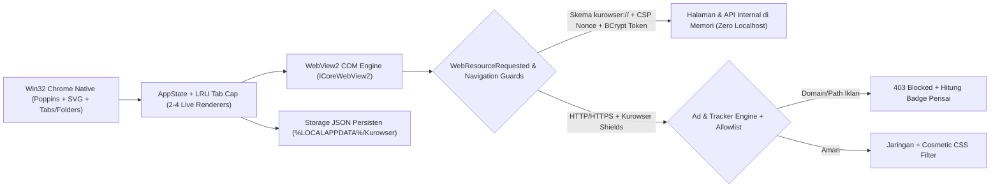
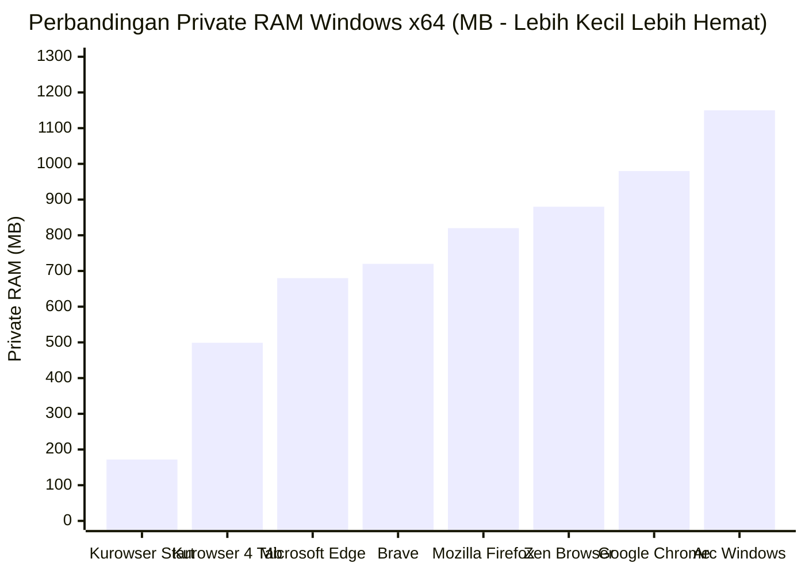

<div align="center">
  
  <h1>Kurowser</h1>
  <p><strong>Browser Windows Ultra-Ringan Berbasis Rust + Native Win32 + WebView2</strong></p>
  <p>Terinspirasi dari <strong>Zen / Arc Tab Folders</strong> dan <strong>Brave Shields</strong> — dirancang agar tetap ngebut, bersih, aman tanpa server <code>localhost</code>, dan hemat RAM saat multitasking maupun gaming.</p>

  <p>
    <a href="https://github.com/devkecelup/kurowser/releases/latest">
      
    </a>
    
    
    
    <a href="LICENSE">
      
    </a>
  </p>
</div>

---

## Fitur Utama Kurowser v1.0.0

- **Arc / Zen Style Tab Folders**
  - Pisahkan CTA sidebar **+ New Tab** dan **Folder** dengan warna penanda folder kustom + garis panduan vertikal di setiap tab anak.
  - **Inline Rename** langsung di sidebar (`Enter` simpan, `Esc` batal), **Collapse / Expand** folder, dan tombol **+ Tab** langsung di dalam folder.
  - **Drag & Drop** tab antar folder atau keluar folder, ditambah **Context Menu (Klik Kanan / `···`)** untuk pindah folder, *Pin/Unpin*, ganti warna, atau tutup seluruh tab dalam folder.
  - Tersimpan otomatis ke `%LOCALAPPDATA%\Kurowser\folders.json` dan **Lazy-Loaded** (tab folder di sesi baru memakai `0 MB` RAM sampai diklik).
- **Brave-Style Kurowser Shields (Ad & Tracker Blocker)**
  - **ON secara default** — memblokir domain & jalur iklan, tracker, analytics, telemetry, popunder, serta cryptominer langsung di `WebResourceRequested` sebelum permintaan keluar ke jaringan.
  - **Cosmetic Element Hiding** menyembunyikan kontainer iklan kosong (`.adsbygoogle`, `[data-ad-slot]`, `[id^="div-gpt-ad"]`, Taboola/Outbrain, dll.).
  - **Ikon Perisai + Badge Live Counter** di address bar untuk toggle *per-site allowlist*, toggle *Global Shields*, toggle *Cosmetic Filter*, atau kelola allowlist lengkap di `kurowser://settings`.
- **Zero `localhost` & Keamanan Terisolasi (`kurowser://`)**
  - Tidak membuka server HTTP lokal (`127.0.0.1`). Halaman internal (`kurowser://start`, `kurowser://history`, `kurowser://bookmarks`, `kurowser://downloads`, `kurowser://settings`) dilayani langsung via **Native WebView2 Custom Scheme** (`ICoreWebView2CustomSchemeRegistration`).
  - Dilengkapi **CSPRNG (`BCryptGenRandom`) session token & per-page CSP nonce**, perbandingan token *constant-time*, `X-Frame-Options: DENY`, pembatasan izin berbahaya, dan proteksi navigasi/iframe lintas origin (lihat [SECURITY.md](SECURITY.md)).
- **Manajemen RAM Agresif (LRU Cap + Lazy Sleep)**
  - Hanya mempertahankan **2–4 renderer tab aktif** secara bersamaan (`default: 3`). Tab terlama otomatis di-*evict* dari memori dan dimuat ulang instan saat diklik, plus tombol **Hemat RAM** satu klik di sidebar.
- **Omnibox Cerdas & Tampilan Kustom (Font Poppins)**
  - Saran instan saat mengetik (`goo` -> `google.com`), pencocokan History & Bookmarks, mesin pencari Google / DuckDuckGo, **6 preset tema** + *Custom Accent Color*, dan *Akses Cepat* yang bisa ditambah/edit bebas.

---

## Arsitektur Native & Alur Keamanan



---

## Perbandingan RAM & Fitur dengan Browser Lain

### Diagram Perbandingan Penggunaan RAM (MB)



> **Catatan Metodologi:**
> - Angka **Kurowser Start (171.7 MB Private / 372.5 MB Working Set)** dan **Kurowser 4 Tab incl. GitHub + Settings + LRU Cap 3/3 (498.7 MB Private / 674.4 MB Working Set)** dengan binary **1.77 MB** dan Rust host **~7.5 MB Private** diukur langsung di Windows 11 x64 menggunakan [`measure_memory.ps1`](measure_memory.ps1).
> - Angka browser pembanding merupakan rentang estimasi *baseline* umum Windows x64 untuk skenario 4 tab aktif tanpa batasan LRU agresif (penggunaan aktual bervariasi tergantung ekstensi, GPU, dan situs yang dibuka).

### Tabel Perbandingan Fitur & Efisiensi

| Fitur / Aspek | Kurowser v1.0.0 | Brave | Microsoft Edge | Google Chrome | Mozilla Firefox | Zen Browser | Arc (Windows) |
|---|---|---|---|---|---|---|---|
| **Ukuran Executable / Base** | **~1.77 MB** (pakai WebView2 OS) | ~350+ MB | Bawaan OS + layanan | ~350+ MB | ~250+ MB | ~270+ MB | ~450+ MB |
| **Stack UI Host** | **Rust + Native Win32 GDI** | Chromium UI | Chromium UI | Chromium UI | Gecko / XUL | Gecko / CSS Mod | Chromium + Swift/WinUI |
| **Arc / Zen Tab Folders** | **Ya (Warna, Collapse, DnD)** | Grup Tab | Tab Vertikal | Grup Tab | Grup Terbatas | **Ya (Native)** | **Ya (Native)** |
| **Ad & Tracker Blocker Bawaan** | **Ya (Kurowser Shields ON)** | **Ya (Brave Shields)** | Tracking Basic | Ekstensi terpisah | ETP Standard | Ekstensi uBlock | Ekstensi uBlock |
| **Batas Tab Hidup (LRU RAM Cap)** | **Ya (2–4 Tab Ketat + Sleep)** | Memory Saver | Sleeping Tabs | Memory Saver | Auto Unload | Tab Unload | Tidur Otomatis |
| **Zero Localhost UI Isolation** | **Ya (`kurowser://` COM)** | Skema `chrome://` | Skema `edge://` | Skema `chrome://` | Skema `about:` | Skema `about:` | Skema internal |
| **Target Utama** | Laptop RAM kecil, gaming, fokus | Privasi web penuh | Integrasi Windows | Ekosistem Google | Open-source Gecko | Estetika Zen | Workspace kreatif |

---

## Pintasan Keyboard (Shortcuts)

| Pintasan | Aksi |
|---|---|
| `Ctrl + T` | Buka tab baru (`kurowser://start`) |
| `Ctrl + W` | Tutup tab aktif |
| `Ctrl + L` / `Alt + D` | Fokus & blok teks address bar |
| `Ctrl + B` | Buka / tutup Sidebar vertikal |
| `Ctrl + D` | Simpan / hapus Bookmark |
| `Ctrl + R` / `F5` | Muat ulang halaman |
| `Ctrl + Tab` / `Ctrl + Shift + Tab` | Pindah ke tab berikutnya / sebelumnya |
| `Ctrl + 1..9` | Lompat ke tab urutan ke-1..9 |
| `Ctrl + H` | Buka `kurowser://history` |
| `Ctrl + J` | Buka `kurowser://downloads` |
| `Ctrl + Shift + O` | Buka `kurowser://bookmarks` |
| `Ctrl + ,` | Buka `kurowser://settings` |
| `Alt + Left` / `Alt + Right` | Navigasi Mundur / Maju |

---

## Instalasi & Build dari Source

### Opsi 1: Unduh Binary Siap Pakai
Unduh `kurowser.exe` terbaru langsung dari halaman **[GitHub Releases](https://github.com/devkecelup/kurowser/releases/latest)** (~1.77 MB, portabel tanpa installer).
> **Prasyarat Windows:** Microsoft Edge WebView2 Runtime (sudah terpasang otomatis di Windows 10/11 modern).

### Opsi 2: Build Sendiri (Rust Toolchain)

```powershell
# 1. Clone repositori
git clone https://github.com/devkecelup/kurowser.git
cd kurowser

# 2. Jalankan unit test (adblock, storage CSPRNG, omnibox, tabs/folders, security guards)
cargo test

# 3. Build binary release teroptimasi (LTO + size opt)
cargo build --release

# 4. Jalankan browser
.\target\release\kurowser.exe
```

Untuk mengukur jejak memori seluruh pohon proses (`kurowser.exe` + sub-proses WebView2) saat berjalan:

```powershell
.\measure_memory.ps1
```

---

## Struktur Modul

- [`src/main.rs`](src/main.rs) — Event loop Win32, koordinasi tab/folder, context menu, drag-and-drop, Shields menu
- [`src/engine.rs`](src/engine.rs) — Native WebView2 COM (`kurowser://` custom scheme, CSP nonces, API token, Shields hook, permission guards)
- [`src/adblock.rs`](src/adblock.rs) — Rule engine domain/path Kurowser Shields & injeksi cosmetic filter
- [`src/tabs.rs`](src/tabs.rs) — Manajemen tab, Tab Folders CRUD, urutan sidebar, dan LRU eviction
- [`src/ui.rs`](src/ui.rs) — Rendering Win32 DPI-aware, font Poppins, ikon SVG/vektor, popup omnibox, inline folder rename
- [`src/pages.rs`](src/pages.rs) — HTML/CSS/JS halaman internal (`kurowser://start`, `history`, `bookmarks`, `downloads`, `settings`)
- [`src/storage.rs`](src/storage.rs) — Penyimpanan JSON persisten, CSPRNG (`BCryptGenRandom`), sanitasi input/path
- [`src/omnibox.rs`](src/omnibox.rs) — Engine saran URL & pencarian address bar

## Lisensi

Dirilis di bawah lisensi **MIT** — lihat [LICENSE](LICENSE).
